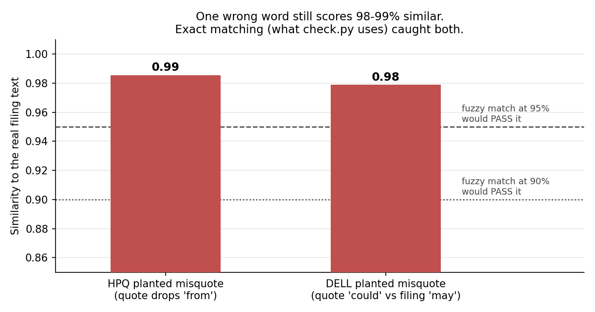

# filing-summarizer

*An AI summary of 10-K risk factors, checked line by line against the filing · 30/30 quotes and 24/24 numbers verified, 6/6 planted errors caught · Python, Claude Opus, SEC EDGAR, BeautifulSoup*

## Why I built this
In every finance role I've had, part of my job was making sure numbers matched their source before anyone relied on them: transaction reconciliation at Tata Capital, data validation at Acer. When I started using AI for analysis, I saw the same risk in a new form: in 2025, Deloitte Australia partially refunded a A$440,000 government report that contained a fabricated judicial quote and nonexistent references produced with AI ([TechSpot](https://www.techspot.com/news/109758-deloitte-admits-ai-hallucinated-quotes-government-report-offers.html)). So I built this to treat AI output like an unreconciled record: nothing gets used until code confirms it against the filing.

## The question and who it's for
**Can an AI summary of a 10-K's risk factors be trusted, and can code prove it?**
For: equity and credit analysts deciding whether an AI-written risk summary is safe to rely on.

## The answer
**Across 6 runs on HP and Dell, all 30 quotes and 24 numbers the AI produced matched the filing, and my checker caught all 6 errors I planted, including one-word changes that still scored 98-99% similar.**



## How I set it up
1. **Data** — The Item 1A Risk Factors section from the latest original 10-K of HP (FY2025) and Dell (FY2026) on SEC EDGAR, pinned by accession number.
2. **Cleaning** — I used the *last* "Item 1A" match to skip the table of contents, removed the page numbers repeated at every page break, and rejoined sentences a page break had split.
3. **Model** — Claude Opus picks the 5 most important risks as JSON, with a word-for-word quote for each. Every call runs isolated: no tools, no access to earlier runs, model pinned.
4. **Output** — A top-5 risk summary per run, 3 runs per company.
5. **Validation** — `check.py` confirms every quote appears exactly in the filing and every number the AI wrote exists there, then I planted a misquote, a changed digit and an invented number to prove it catches them.

## How I used it
I read the verified top 5 for HP and Dell side by side. Both companies' first three picks were the same in every run. Supplier dependence ranks near the top for both, but HP's exposure is print supplies and memory costs, while Dell's is AI customer concentration and $31.5 billion of debt, the risk a credit analyst would look at first. These verified lists are the starting point for my next project, a deeper HP vs. Dell comparison.

## Key decisions and why
- I chose **exact quote matching** over **fuzzy matching** because one wrong word ("could" for "may") still scored 0.98 similar; a fuzzy rule would have passed the exact error I was trying to catch.
- I chose **Risk Factors** over **MD&A** because this project tests whether the AI quotes honestly, and Risk Factors is long, quotable prose; MD&A is mostly numbers, which my later projects cover.
- I chose **two companies** over **one** because HP and Dell format their filings differently. Dell bolds every heading the same way, which broke my first rule for finding risk headings and forced a better one.

## What worked, what didn't, and why
- 30/30 quotes matched word for word and 24/24 numbers were found in the filing, across 6 runs.
- The checker caught 6/6 planted errors, and both companies' top 3 risks were identical in every run.
- My first AI calls weren't isolated: in principle a run could read earlier outputs, which made "3 independent runs" untrue. I isolated every call, and reran all results instead of keeping them.
- The checker confirms a number *exists* in the filing, not that it's used with the right meaning. I checked the 6 numbers the AI wrote in its own words by hand; all were right, but that step isn't automated yet. Details and other limits: [docs/details.md](docs/details.md).

## What I'd do next
- Automate the context check: compare the words around each number in the AI's text with the words around it in the filing.
- Run the same checks across more companies and both Claude Opus and Sonnet, to measure how often each model misquotes rather than showing that one model didn't.

## How I used AI
I set the requirement and success criteria, made the design decisions, ran and reviewed every result, and caught that the first AI calls weren't isolated and that the consistency metric used the wrong denominator; Claude wrote the code and tests to my specifications, proposed technical approaches I accepted or rejected, and helped draft this README.

## Run it
```bash
git clone https://github.com/pooja003-cloud/filing-summarizer && cd filing-summarizer
pip install -r requirements.txt
python run_all.py --pause 20
```
Needs [Claude Code](https://claude.com/claude-code) logged in (no API key; it uses a Claude Pro login) and `SEC_USER_AGENT="Your Name your@email.com"` set for SEC EDGAR.

## What's inside
```
summarize.py      fetch the 10-K → extract Item 1A → ask Claude (isolated) → save
check.py          verify quotes and numbers, planted errors, run-to-run consistency
run_all.py        reproduce every result into one fresh log (outputs/run_output.txt)
textnorm.py       one shared text-cleaning function for the filing and the AI's quotes
tests/            19 unit tests and a fake 10-K packed with the known traps
DECISIONS.md      every design decision and the reasoning behind it
docs/details.md   full results, data quality, limitations and related research
```
